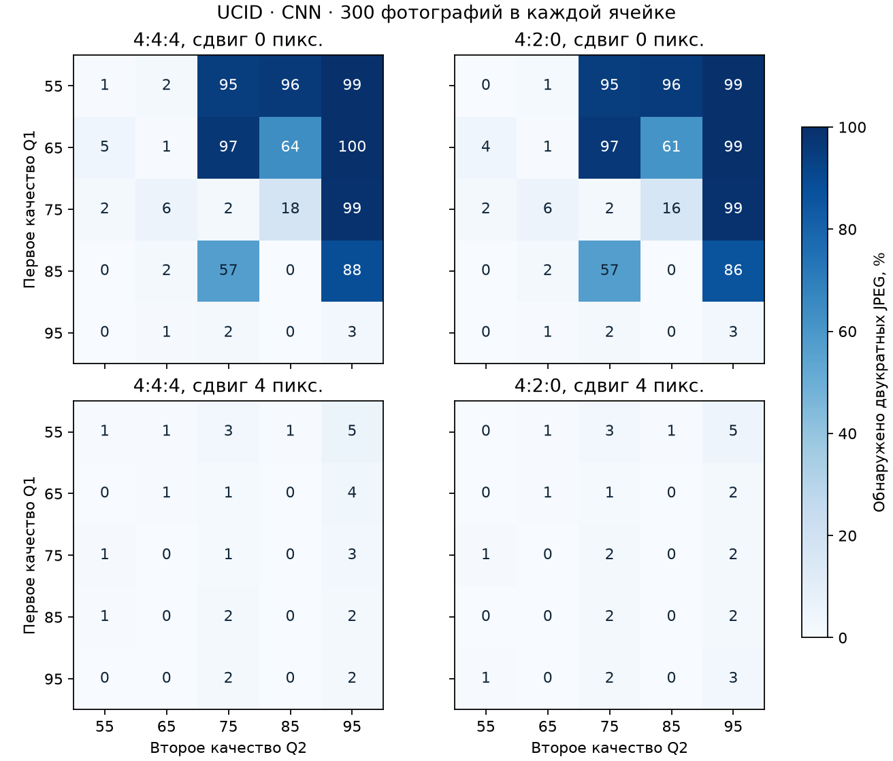

# Результаты исследования повторного JPEG-сжатия

Для программы выбрана одномерная свёрточная сеть (CNN). На отложенной выборке DJPEG она правильно определила класс 4 022 из 5 000 файлов (80,44 %). У персептрона (MLP) — 3 936 правильных ответов (78,72 %). Свёрточная сеть реже помечала однократно сжатые фотографии как двукратно сжатые. На отдельном наборе UCID результат сильно зависел от того, с каким качеством второй раз сохранили фотографию и совпали ли сетки блоков JPEG.

## Данные и обучение

Для обучения взяты готовые размеченные файлы DJPEG. В каждой паре один фрагмент сцены представлен после одного и двух сжатий. Из полного архива выбраны 20 000 пар, из них 15 000 для обучения, 2 500 для валидации и 2 500 для теста. Обе версии фрагмента и соседние идентификаторы из одной группы по 1 000 номеров всегда попадают в одну выборку. Совпадений декодированных изображений между выборками нет. Привязка к исходным фотографиям в архиве отсутствует, поэтому фрагменты одной фотографии могут оказаться в разных выборках. Для отдельной проверки взяты фотографии UCID. [Статья авторов DJPEG](https://openaccess.thecvf.com/content_ECCV_2018/html/Jin-Seok_Park_Double_JPEG_Detection_ECCV_2018_paper.html) · [Манифест выборок](../research/manifest.csv.gz)

Обе сети получают гистограммы девяти низкочастотных коэффициентов дискретного косинусного преобразования яркости и таблицу квантования из заголовка JPEG. MLP обрабатывает весь вектор из 1 171 признака. CNN ищет локальные закономерности вдоль интервалов гистограммы, затем учитывает таблицу квантования. В MLP 77 154 обучаемых параметра, в CNN — 35 170.

Каждая сеть обучена с нуля трижды на GPU Apple M4 Pro с начальными значениями генератора случайных чисел 17, 29 и 43. Использованы Adam, шаг 0,001, пакеты по 256 примеров и предел в 20 эпох. Веса для сравнения и программы выбраны по минимальной кросс-энтропии на валидации. У MLP это 7-я эпоха запуска 17, у CNN — 17-я эпоха запуска 29. Среднее по трём запускам значение accuracy на тесте составило 78,18 % у MLP и 80,29 % у CNN, стандартное отклонение — 0,95 и 0,22 процентного пункта соответственно. [Журнал обучения](../research/runs.csv) · [Кривые валидационной ошибки](../research/learning.png)

## Ошибки на тесте DJPEG

Положительный класс — двукратное сжатие. Precision показывает, какая доля файлов, отмеченных программой, действительно сжата дважды. Полнота показывает, какую долю двукратно сжатых файлов программа обнаружила. Порог для обеих моделей равен 0,5.

| Модель | Accuracy | Precision | Полнота | F1 | Ложные срабатывания из 2 500 | Пропуски из 2 500 |
|---|---:|---:|---:|---:|---:|---:|
| MLP | 78,72 % | 84,85 % | 69,92 % | 0,767 | 312 | 752 |
| CNN | **80,44 %** | **88,79 %** | 69,68 % | **0,781** | **220** | 758 |

При замене MLP на CNN в список для ручного просмотра попало на 92 меньше однократно сжатых файлов, а число пропущенных двукратно сжатых выросло на 6. Прирост accuracy равен 1,72 п. п. При повторной выборке 2 500 пар с возвращением 95 %-й бутстреп-интервал этой разности составил от 0,86 до 2,64 п. п. Он описывает разброс по фрагментам данного теста. Контрольный классификатор выбирал самый частый обучающий класс для каждой последней таблицы квантования и дал 51,22 % правильных ответов. [Метрики шести запусков](../research/test-metrics.csv) · [Предсказания для каждого файла](../research/test-predictions.csv.gz)

В 83 тестовых парах после декодирования совпали все пиксели, а в трёх совпали даже байты JPEG. Для этих трёх пар историю сохранения восстановить однозначно невозможно. У 11 тестовых файлов весь вектор входных признаков уже встречался на обучении или валидации. После их исключения CNN верно классифицировала 80,44 % из оставшихся 4 989 файлов. [Результаты проверки совпадений](../research/sample-checks.json)

## Какие параметры сжатия влияют на результат

Из UCID случайно выбраны 300 несжатых TIFF-фотографий. Для каждой взят один и тот же фрагмент сцены во всех вариантах сохранения. Параметры качества Pillow при первом и втором сохранении, Q1 и Q2, принимали значения 55, 65, 75, 85 и 95. Каждое сочетание воспроизведено с цветовой субдискретизацией 4:4:4 и 4:2:0, при совпадении сеток блоков и при сдвиге второй сетки на четыре пикселя по обеим осям. Всего получено 30 000 двукратно и 3 000 однократно сжатых JPEG. Это варианты 300 сцен. [Исходные фотографии UCID](https://github.com/girfa/ColorImageDatasets/tree/cea0b27af75c2e9d4f966153bc6d7544c1a8df25/UCID-1338)

В таблице приведена доля двукратно сжатых JPEG, обнаруженных выбранной CNN. Для каждой строки объединены результаты двух вариантов субдискретизации.

| Качество второго сохранения | Совпадающая сетка | Сдвиг сетки на 4 пикселя |
|---|---:|---:|
| Выше первого, Q2 > Q1 | 4 520 / 6 000 **(75,33 %)** | 108 / 6 000 (1,80 %) |
| Равно первому, Q2 = Q1 | 38 / 3 000 (1,27 %) | 30 / 3 000 (1,00 %) |
| Ниже первого, Q2 < Q1 | 444 / 6 000 (7,40 %) | 43 / 6 000 (0,72 %) |

Из 3 000 однократно сжатых файлов CNN ошибочно отметила 40 (1,33 %), MLP — 76 (2,53 %). Чтобы соотношение числа вариантов двух классов не определяло итоговую оценку, для UCID взято среднее полноты двух классов (balanced accuracy). При совпадении сеток оно составило 66,01 % у CNN и 65,84 % у MLP. При сдвиге — 49,94 % и 49,93 %. Эти значения относятся к выбранной сетке параметров, где каждое сочетание встречается одинаково часто. [Результаты по сочетаниям параметров](../research/compression.csv) · [Предсказания на UCID](../research/ucid-predictions.csv.gz)

- **Имеет значение конкретная пара значений качества.** Например, при 4:2:0 и совпадающей сетке CNN обнаружила повторное сохранение в 298 из 300 случаев для перехода 55 → 95 и только в 4 из 300 для перехода 55 → 65. Более тонкое второе квантование может сохранить промежутки между значениями коэффициентов, возникшие при первом сжатии. Их выраженность зависит от соотношения шагов квантования на отдельных частотах.
- **При одинаковых настройках сеть почти всегда пропускает второе сохранение.** При повторном округлении с тем же шагом многие коэффициенты получают прежние значения. Подобные случаи редко встречались в обучении — одинаковый номер первой и последней таблиц был только у 17 из 15 000 двукратно сжатых примеров. По этому эксперименту разделить вклад состава обучающей выборки и самого квантования нельзя.
- **Сдвиг сетки влияет сильнее, чем субдискретизация цвета.** При совпадении сеток CNN обнаружила 33,52 % всех повторных сжатий в режиме 4:4:4 и 33,17 % в режиме 4:2:0. При сдвиге на четыре пикселя общая полнота упала до 1,21 %. После сдвига коэффициенты вычисляются по другим группам пикселей. Близкие результаты двух цветовых режимов согласуются с тем, что модель использует яркостную компоненту.

## Сколько времени занимает классификация

Замеры выполнены на CPU Apple M4 Pro под macOS 26.5 с одним потоком PyTorch. При загруженной модели в измерение входят открытие файла, декодирование JPEG, расчёт признаков и получение класса. Обе сети обработали одни и те же 1 000 файлов размером 256 × 256 в трёх проходах после прогрева. Для запуска из командной строки дополнительно измерены 20 новых процессов на модель с загрузкой библиотек и весов. Файловый кеш ОС был прогрет в обоих опытах.

| Модель | Файл при загруженной модели, медиана | 95-й процентиль | Отдельная команда Python, медиана |
|---|---:|---:|---:|
| MLP | 0,512 мс | 0,694 мс | 0,917 с |
| CNN | 0,546 мс | 0,747 мс | 0,907 с |

Для обработки каталога веса загружаются один раз. При запуске команды для одной фотографии большую часть времени занимает запуск Python с библиотеками и моделью. Замер на фрагментах 256 × 256 также нельзя напрямую переносить на полноразмерные снимки. Pillow декодирует JPEG до выделения центрального фрагмента. [Замеры обработки файлов](../research/timing.csv.gz) · [Замеры отдельных запусков](../research/cli-timing.csv)

## Практический вывод

CNN подходит для предварительного отбора фотографий с признаками повторного сохранения. На тесте DJPEG её преимущество перед MLP состояло в меньшем числе ложных срабатываний при близкой полноте. На фотографиях UCID программа чаще всего находила повторное сжатие при сохранении сетки блоков и заметном повышении качества. Если снимок обрезали со сдвигом сетки или сохранили с тем же качеством, ответ «однократное сжатие» малоинформативен. Обнаруженное повторное сжатие указывает на историю сохранения и само по себе не устанавливает факт монтажа.
