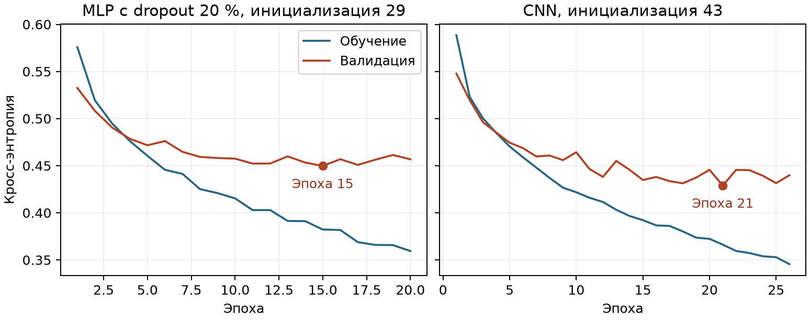
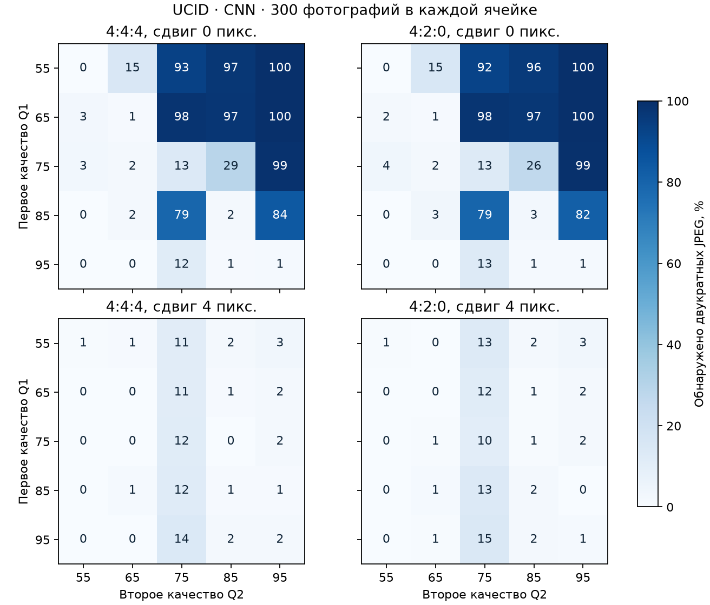

# Обнаружение повторного JPEG-сжатия. Результаты эксперимента

На тесте DJPEG свёрточная сеть (CNN) верно классифицировала 4 033 из 5 000 JPEG, персептрон (MLP) с dropout 20 % — 3 958. Для программы по валидационной кросс-энтропии выбрана CNN с 16 и 32 каналами. На внешних фотографиях UCID она лучше всего находила повторное сохранение при повышении качества JPEG и совпадении сеток блоков. [Выполненный ноутбук](../train.ipynb)

## Данные и обучение

Из авторского архива DJPEG отобраны 20 000 пар. Обе версии фрагмента остаются вместе. Для обучения использованы 15 000 пар, для валидации и теста — по 2 500. Соседние номера фрагментов группировались по 1 000. Между выборками нет совпадений декодированных изображений. Архив не раскрывает идентификаторы исходных фотографий, поэтому разные фрагменты одного снимка могли оказаться в разных выборках. Программа получает девять гистограмм низкочастотных коэффициентов ДКП и 64 элемента последней таблицы квантования. [Статья авторов DJPEG](https://openaccess.thecvf.com/content_ECCV_2018/html/Jin-Seok_Park_Double_JPEG_Detection_ECCV_2018_paper.html) · [Манифест](../research/manifest.csv.gz)

Обе сети обучены с нуля на GPU Apple M4 Pro. Для каждой использованы инициализации 17, 29 и 43, Adam с шагом 0,001 и пакеты по 256 примеров. Сохранялись веса эпохи с минимальной кросс-энтропией на 5 000 валидационных JPEG. После пяти эпох без улучшения обучение завершалось. В таблице приведены средние результаты трёх запусков в выбранных таким образом эпохах.

| Вариант | Параметры | Предел эпох | Кросс-энтропия на валидации | Верных ответов на валидации |
|---|---:|---:|---:|---:|
| MLP без dropout | 77 154 | 20 | 0,4611 | 77,68 % |
| MLP с dropout 20 % | 77 154 | 60 | 0,4507 | 78,15 % |
| CNN, 16 и 32 канала | 35 170 | 20 | 0,4315 | 79,49 % |
| CNN, 16 и 32 канала | 35 170 | 60 | 0,4298 | 79,93 % |
| CNN, 32 и 64 канала | 71 266 | 60 | 0,4297 | 80,01 % |

У исходного MLP минимум валидационной потери приходился на 5–7-ю эпохи. С dropout после двух скрытых слоёв потеря снизилась во всех трёх запусках. Выбран запуск 29, эпоха 15, кросс-энтропия 0,4497. Обычная CNN во всех трёх запусках нашла лучшие веса на 21-й эпохе и остановилась на 26-й. Для программы выбрана инициализация 43 с потерей 0,4290. Удвоение числа каналов дало менее 0,1 процентного пункта к средней доле правильных ответов. Этот опыт ограничен валидационной выборкой. [Запуски двух основных моделей](../research/runs.csv) · [Контроль ширины CNN](../research/width-control.csv) · [Сравнение настроек](../research/validation-comparison.csv)

## Качество на тесте DJPEG

В прежнем и итоговом опытах использованы одни и те же 5 000 файлов. Положительный класс — двукратное сжатие. Порог оценки равен 0,5. В таблице FP — число однократно сжатых файлов, попавших в список для ручного просмотра, FN — число пропущенных повторных сжатий. В каждом классе по 2 500 файлов.

| Вариант | Инициализация / эпоха | Верных ответов | Precision | Полнота | F1 | FP | FN |
|---|---:|---:|---:|---:|---:|---:|---:|
| MLP, исходный | 17 / 7 | 78,72 % | 84,85 % | 69,92 % | 0,767 | 312 | 752 |
| MLP с dropout, итоговый | 29 / 15 | **79,16 %** | 89,03 % | 66,52 % | 0,761 | 205 | 837 |
| CNN, исходная | 29 / 17 | 80,44 % | 88,79 % | 69,68 % | 0,781 | 220 | 758 |
| CNN, итоговая | 43 / 21 | **80,66 %** | 90,75 % | 68,28 % | 0,779 | 174 | 793 |

Среди итоговых моделей CNN пропустила на 44 повторных сжатия меньше, чем MLP, и дала на 31 меньше ложных срабатываний. Разница в доле верных ответов составила 1,50 п. п. Парный 95 %-й бутстреп-интервал по 2 500 фрагментам теста — от 0,58 до 2,36 п. п. Средняя по трём инициализациям доля верных ответов составила 80,70 % у CNN и 78,80 % у MLP. Выборочные стандартные отклонения равны 0,66 и 0,68 п. п. [Метрики шести запусков](../research/test-metrics.csv) · [Предсказания по файлам](../research/test-predictions.csv.gz)

По сравнению с прежними весами итоговая CNN правильно классифицировала на 11 файлов больше, итоговая MLP — на 22. Обе стали реже отмечать однократно сжатые снимки и чаще пропускать двукратно сжатые. Для CNN изменение доли верных ответов составило +0,22 п. п. с парным 95 %-м интервалом от −0,56 до +1,02, для MLP — +0,44 п. п. с интервалом от −0,40 до +1,24. Оба интервала включают ноль. [Сопоставление двух опытов](../research/protocol-comparison.csv) · [Парные разности и их интервалы](../research/protocol-deltas.csv) · [Исходный опыт целиком](../archive/20-epochs/)

Классификатор, который выбирал самый частый обучающий класс для последней таблицы квантования, дал 51,22 % верных ответов. В 83 тестовых парах совпали все декодированные пиксели, в трёх совпали даже байты JPEG при разных метках истории сохранения. У 11 файлов вектор признаков встречался на обучении или валидации. После их исключения у CNN 80,74 % верных ответов на 4 989 файлах. [Проверка совпадений](../research/sample-checks.json)

## Качество на фотографиях UCID

Для каждой из 300 несжатых TIFF-фотографий получены варианты одного фрагмента при пяти значениях качества JPEG (55, 65, 75, 85 и 95), цветовой субдискретизации 4:4:4 и 4:2:0, совпадающих сетках блоков и сдвиге на четыре пикселя по обеим осям. Всего получилось 30 000 двукратно сжатых и 3 000 однократно сжатых файлов. Параметр Q1 относится к первому сохранению, Q2 — ко второму. В таблице показана полнота, результаты двух вариантов субдискретизации объединены. [Исходные фотографии UCID](https://github.com/girfa/ColorImageDatasets/tree/cea0b27af75c2e9d4f966153bc6d7544c1a8df25/UCID-1338) · [Предсказания для всех 33 000 файлов](../research/ucid-predictions.csv.gz)

| Качество второго сохранения | Файлов на режим | MLP, сетки совпадают | CNN, сетки совпадают | MLP, сдвиг | CNN, сдвиг |
|---|---:|---:|---:|---:|---:|
| Выше первого | 6 000 | 75,98 % | **80,92 %** | 1,00 % | 3,47 % |
| Равно первому | 3 000 | 1,03 % | 3,60 % | 0,57 % | 2,90 % |
| Ниже первого | 6 000 | 4,57 % | 10,38 % | 0,60 % | 3,20 % |

При совпадающих сетках и 4:2:0 CNN обнаружила переход 55 → 95 на всех 300 фотографиях и переход 55 → 65 на 46 снимках. При равном качестве повторное округление часто даёт прежнее значение коэффициента. В обучении одинаковые номера первой и последней таблиц встретились лишь в 17 из 15 000 двукратных JPEG. Эксперимент показывает совокупное влияние настроек сжатия и обучающей выборки. [Результаты по сочетаниям параметров](../research/compression.csv)

При совпадающих сетках средняя полнота CNN составила 37,32 % для 4:4:4 и 37,16 % для 4:2:0. При сдвиге сеть обнаружила 487 из 15 000 повторно сжатых JPEG (3,25 %). При этом на 3 000 однократно сжатых она дала 102 ложных срабатывания (3,40 %). У MLP соответствующие числа — 113 (0,75 %) и 32 (1,07 %).

| Среднее полноты двух классов на UCID | Сетки совпадают | Сдвиг на четыре пикселя |
|---|---:|---:|
| MLP, исходный опыт | 65,84 % | 49,93 % |
| MLP с dropout, итоговый опыт | 65,68 % | 49,84 % |
| CNN, исходный опыт | 66,01 % | 49,94 % |
| CNN, итоговый опыт | **66,92 %** | **49,92 %** |

При совпадающей сетке итоговая CNN распознаёт больше двукратных сжатий, чем прежняя, но чаще срабатывает и на контрольных фотографиях (102 ложных ответа против 40). При сдвиге среднее полноты двух классов у обеих моделей остаётся около 50 %. Результат относится к 300 сценам и равномерно представленным сочетаниям параметров.

## Время обработки

Измерения выполнены на CPU Apple M4 Pro в одном потоке PyTorch. Обе модели обработали одни и те же 1 000 JPEG размером 256 × 256 в трёх проходах после прогрева. Измерены открытие файла, декодирование, расчёт признаков и классификация. Для отдельной команды учтены также запуск Python и загрузка библиотек и весов, по 20 новых процессов на модель. [Измерения по файлам](../research/timing.csv.gz) · [Время запуска команды](../research/cli-timing.csv)

| Модель | Загруженная модель, медиана | 95-й процентиль | Отдельная команда, медиана |
|---|---:|---:|---:|
| MLP с dropout | 0,495 мс | 0,652 мс | 0,854 с |
| CNN | 0,520 мс | 0,679 мс | 0,859 с |

В одном процессе разница медиан между сетями составила 0,025 мс на файл. При обработке каталога веса загружаются один раз. Для полноразмерных снимков время может быть больше, поскольку Pillow декодирует изображение до выделения центрального фрагмента.

## Практический вывод

На DJPEG итоговая CNN даёт более точный список файлов для ручного просмотра и обнаруживает больше повторных сжатий, чем итоговая MLP. На UCID применимость существенно зависит от сетки блоков и настроек второго сохранения. Отрицательный ответ при неизвестной обработке фотографии оставляет вопрос о числе сохранений открытым.
